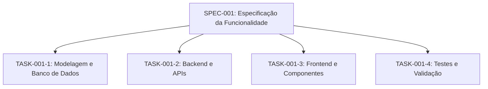

# Especificações (Specs)

Esta pasta contém os documentos de especificação de funcionalidades e requisitos do projeto.

## Relação com Tasks
> **Regra:** Uma especificação (`spec`) pode possuir **múltiplas tarefas (`tasks`)** para viabilizar entregas incrementais e organizadas.

## Padrão de Nomenclatura
- Arquivos de spec: `specs/SPEC-XXX-nome-da-funcionalidade.md` (Exemplo: `SPEC-001-autenticacao.md`)

## Estrutura de uma Spec
Para criar uma nova especificação, utilize como base o arquivo [`TEMPLATE.md`](./TEMPLATE.md):
1. **Identificador & Título** (`SPEC-XXX`)
2. **Contexto & Objetivo**
3. **Requisitos Funcionais & Regras de Negócio**
4. **Critérios de Aceite**
5. **Tasks Vinculadas** (links para as tarefas em `/tasks/SPEC-XXX/`)

